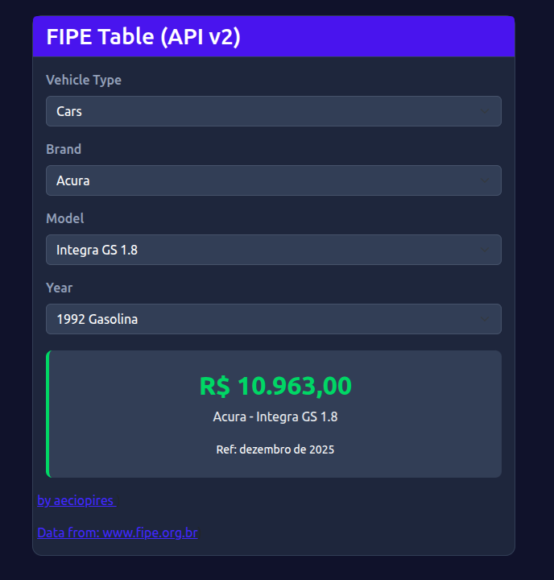
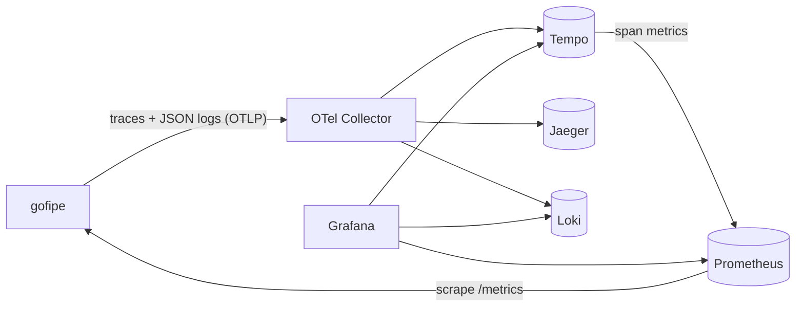
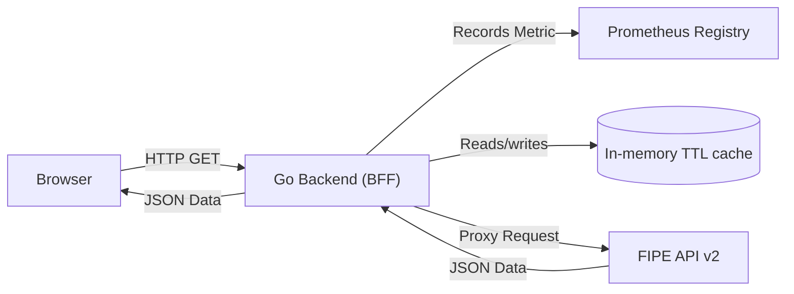

# gofipe

<!-- TOC -->

- [gofipe](#gofipe)
- [Introduction](#introduction)
  - [Features](#features)
- [Documentation](#documentation)
- [Requirements](#requirements)
- [Running using Docker](#running-using-docker)
- [Running locally without Docker](#running-locally-without-docker)
  - [Configuration](#configuration)
- [Build image](#build-image)
- [Deploy on Kubernetes](#deploy-on-kubernetes)
- [Architecture](#architecture)
    - [API Endpoints](#api-endpoints)
    - [Metrics Documentation](#metrics-documentation)
- [Developers](#developers)
- [License](#license)

<!-- TOC -->

# Introduction

A web application that provides a user-friendly interface to search the Brazilian FIPE vehicle price table.

References:
- https://www.fipe.org.br
- https://fipe.online/docs/comece-aqui

It implements a Backend in [Go](https://go.dev/) (acting as a proxy to the [FIPE data source](https://fipe.online/docs/api/fipe) and serving the Frontend), a simple Frontend using Go HTML Templates, [Prometheus](https://prometheus.io) metrics, and [Docker](https://docs.docker.com/get-started/) configurations.

## Features

- **FIPE API v2 Integration**: Fully compatible with the latest FIPE API endpoints (English parameters). Optional `FIPE_API_TOKEN` for higher rate limits.
- **BFF Proxy**: Hides external API details from the frontend and handles CORS/Rate-limiting strategies centrally.
- **Input validation**: vehicle type and IDs are validated before reaching the FIPE API (no path/query injection).
- **Single binary**: HTML, CSS and JS are embedded with `go:embed`.
- **Theme support**: day/night layout with a client-side toggle.
- **Real price history**: `/api/priceHistory` uses the FIPE v2 history endpoint (by FIPE code) and returns the real reference months.
- **Smart cache**: in-memory TTL cache for brands/models/years/prices/history, with periodic cleanup of expired entries.
- **Robust errors**: meaningful HTTP status codes (400/404/429/502/504) without leaking internal details.
- **Production-ready server**: HTTP timeouts, graceful shutdown on `SIGTERM` (readiness turns `503` and the server drains for `SHUTDOWN_DELAY`).
- **Health Checks**: ``/health/live`` (liveness/startup), ``/health/ready`` (readiness) and ``/health`` (Docker `HEALTHCHECK`).
- **JSON logs**: one JSON object per line (`log/slog`), with `trace_id`/`span_id` inside requests and a JSON access log per request.
- **Tracing with OpenTelemetry**: server spans per route and client spans for each FIPE call, exported with OTLP (enabled by the standard `OTEL_EXPORTER_OTLP_ENDPOINT`).
- **Full observability stack**: `docker compose` with OpenTelemetry Collector, Prometheus, Loki, Tempo, Jaeger and Grafana, with provisioned data sources and dashboards that link metrics ↔ logs ↔ traces.
- **Prometheus Metrics**:
  - **Standard Go runtime/process metrics**.
  - **HTTP request counter and latency histogram** per route, with bounded cardinality and trace exemplars.
  - **Custom Business Metrics**: Tracks specific searches by Brand, Model, and Year, real min/max observed prices, fuel and brand counters.
- **Dockerized**: multi-arch, non-root image with healthcheck, ready to run with [docker compose](https://docs.docker.com/compose/).
- **Helm chart**: ready to deploy in Kubernetes cluster with [Helm 4](https://helm.sh/).
- **Tooling with mise**: every development tool is pinned in [mise.toml](mise.toml); `make install-deps` / `make check-deps` set up Ubuntu 22.04/24.04/26.04 (amd64) and macOS (amd64/arm64).
- **Quality gates**: unit tests, golangci-lint, govulncheck, hadolint, trivy, shellcheck and `helm lint --strict`.

# Documentation

New to the project (or to programming)? Start with the beginner-friendly guides in [docs/](docs/README.md). They explain the features and the architecture with analogies and diagrams.

# Requirements

See [REQUIREMENTS.md](REQUIREMENTS.md). In short:

```bash
# Install Docker + Docker Compose first (not managed by this repository), then:
make install-deps   # OS packages + mise + Go, Helm 4, kubectl, trivy, linters...
make check-deps     # verify everything
```

# Running using Docker

Install Docker: https://docs.docker.com/get-started/get-docker/ 

Run the container

```bash
docker run -d -p 8080:8080 --rm --name gofipe aeciopires/gofipe:4.1.0
```

Access the application:
- UI: Open http://localhost:8080
- Metrics: Open http://localhost:8080/metrics.
- Health: Open http://localhost:8080/health/live and http://localhost:8080/health/ready.



# Running locally without Docker

Install the requirements (see [REQUIREMENTS.md](REQUIREMENTS.md)), then run the application:

```bash
cd app
make run      # same as: mise exec -- go run .
```

Access the application at http://localhost:8080.

Other useful targets (run `make help` to see all of them):

```bash
make test     # unit tests with the race detector
make lint     # golangci-lint + hadolint
make vuln     # govulncheck
make build    # builds bin/gofipe
```

## Configuration

The application is configured with environment variables:

| Variable | Default | Description |
|----------|---------|-------------|
| `PORT` | `8080` | HTTP port the server listens on. |
| `FIPE_BASE_URL` | `https://fipe.parallelum.com.br/api/v2` | Base URL of the FIPE API v2. |
| `FIPE_API_TOKEN` | *(empty)* | Optional subscription token from https://fipe.online (sent as `X-Subscription-Token`). Raises rate limits and allows longer price history. |
| `SHUTDOWN_DELAY` | `0s` | Time to keep serving after `SIGTERM` while `/health/ready` returns `503` (e.g. `5s`; the Helm chart sets it). |
| `OTEL_EXPORTER_OTLP_ENDPOINT` | *(empty)* | OTLP/HTTP endpoint (e.g. `http://localhost:4318`). When set, traces and logs are exported with OpenTelemetry. Other standard `OTEL_*` variables are honoured (`OTEL_SERVICE_NAME`, default `gofipe`; `OTEL_RESOURCE_ATTRIBUTES`; `OTEL_SDK_DISABLED`). |

Logs are always written to stdout as JSON, for example:

```json
{"time":"2026-11-16T09:43:42.143Z","level":"INFO","msg":"http request","trace_id":"598881fd27620572fb8cfe571cd92d78","span_id":"4961979fb901f0bb","method":"GET","route":"/api/models","status":404,"duration_ms":14}
```

# Build image

Requirements: see [REQUIREMENTS.md](REQUIREMENTS.md) (Docker with Buildx is required).

Build, push the multi-arch image (`linux/amd64`, `linux/arm/v6`, `linux/arm/v7`, `linux/arm64`) to Docker Hub and scan it with trivy:

```bash
cd app
make image
```

Build and scan only for the local platform (no push):

```bash
cd app
make image-local scan
```

# Observability stack (metrics, logs and traces)

Run the app with the OpenTelemetry Collector, Prometheus, Loki, Tempo, Jaeger and Grafana:

```bash
cd app
make compose-up     # docker compose up -d --build
make compose-down
```

| Service | URL |
|---------|-----|
| gofipe | http://localhost:8080 |
| Grafana (`admin` / `admin`) – dashboards in folder *gofipe* | http://localhost:3000 |
| Prometheus | http://localhost:9090 |
| Jaeger UI | http://localhost:16686 |
| Loki / Tempo APIs | http://localhost:3100 / http://localhost:3200 |
| OTLP (Collector) | `localhost:4317` (gRPC), `localhost:4318` (HTTP) |

If a port is busy, override it, e.g. `GRAFANA_PORT=13000 GOFIPE_PORT=18080 make compose-up`.



Provisioned dashboards (`app/dashboard/`): **gofipe - Overview** (RED metrics with exemplars, logs, traces, service graph), **gofipe - Logs**, **gofipe - Traces** and **gofipe - Business**. Grafana's Jaeger plugin does not support Jaeger 2.21+ (it only serves `/api/v3`), so traces are explored in Grafana through Tempo and in the Jaeger UI directly. Details: [docs/06-observability.md](docs/06-observability.md).

# Deploy on Kubernetes

The chart in [helm-chart/](helm-chart/README.md) requires **Helm 4** (Helm 3 is no longer supported).

```bash
cd helm-chart
make lint
make install
kubectl port-forward svc/gofipe 8080:80 -n gofipe
```

# Architecture

To fulfill the requirement of tracking specific metrics (like "most searched model"), the Backend acts as a **BFF (Backend for Frontend)** [[1](https://medium.com/digitalproductsdev/arquitetura-bff-back-end-for-front-end-13e2cbfbcda2)] and [[2](https://dev.to/abdulnasirolcan/backend-for-frontend-bff-architecture-4p11)].

- **Frontend**: A server-side rendered [HTML](https://www.w3schools.com/html/) template (``templates/index.html``) served by Go. It uses [Vanilla JS](http://vanilla-js.com/) to fetch data from the Go backend.
- **Backend**: Written in Go. It exposes a clean internal API that mirrors the FIPE structure.
- **Observability**: Uses [prometheus/client_golang](https://github.com/prometheus/client_golang) to expose system and business metrics, `log/slog` for JSON logs and [OpenTelemetry](https://opentelemetry.io/docs/languages/go/) for traces and log export.

> Note: I am using the public API https://fipe.parallelum.com.br/api/v2 for this implementation. It is the community standard for FIPE data in Brazil, is free, requires no API keys, and uses the standard REST structure (Brands > Models > Years).

- The Browser calls the Go Backend.
- The Go Backend validates the input and answers from its cache when possible.
- The Go Backend forwards the request to the public [FIPE API](https://fipe.online/docs/api/fipe).
- The Go Backend records the Prometheus metrics.

For a detailed, beginner-friendly explanation see [docs/02-architecture.md](docs/02-architecture.md).



### API Endpoints

The backend exposes the following endpoints:

**System Endpoints**

|Method | Endpoint | Description |
|-------|----------|-------------| 
| ``GET`` | ``/health`` | Returns ``200 OK`` ``{"status": "ok"}`` if the app is running (Docker `HEALTHCHECK`). |
| ``GET`` | ``/health/live`` | Liveness: ``200 OK`` ``{"status": "ok"}`` while the process answers HTTP. |
| ``GET`` | ``/health/ready`` | Readiness: ``200 OK`` ``{"status": "ok"}``, or ``503`` ``{"status": "unavailable"}`` while starting or shutting down. |
| ``GET`` | ``/metrics`` | Exposes data in Prometheus/OpenMetrics format (with exemplars). |
| ``GET`` | ``/static`` | Exposes static assets. |

**Business API (Proxy)**

These endpoints proxy requests to https://fipe.parallelum.com.br/api/v2.

|Method | Endpoint | Params (Query String) | Description |
|-------|----------|-----------------------|-------------| 
| ``GET`` | ``/api/brands`` | ``type`` (cars, motorcycles, trucks; default cars) | Lists vehicle brands (cached 12h).|
| ``GET`` | ``/api/models`` | ``type``, ``brandId`` | Lists models for a brand (cached 12h).|
| ``GET`` | ``/api/years`` | ``type``, ``brandId``, ``modelId`` | Lists available years for a model (cached 24h).|
| ``GET`` | ``/api/price`` | ``type``, ``brandId``, ``modelId``, ``yearId`` | (**Critical**) Returns the price and records the business metrics (cached 1h). |
| ``GET`` | ``/api/priceHistory`` | ``type``, ``brandId``, ``modelId``, ``yearId``, ``months`` (1-24, default 12) | Returns ``{"history": [...]}``, newest first, using the FIPE history endpoint. The free FIPE tier returns up to 3 months. |

Invalid parameters return ``400``, other HTTP methods return ``405``, and upstream failures return ``404``/``429``/``502``/``504``.


### Metrics Documentation

The application exposes the following Prometheus metrics at ``/metrics`` endpoint:

- **Metric**: ``fipe_http_requests_total``:
   - **Type**: Counter
   - **Description**: Total number of HTTP requests processed by the server.
   - **Labels**: 
     - ``path``: The matched route (e.g., ``/api/brands``); unknown URLs are grouped as ``unmatched``.
     - ``method``: The HTTP method used (e.g., ``GET``); non-standard methods are grouped as ``OTHER``.
- **Metric**: ``fipe_http_request_duration_seconds``:
   - **Type**: Histogram
   - **Description**: Duration of HTTP requests. Each observation inside a sampled trace carries the ``trace_id`` as an exemplar (visible in Grafana, links to Tempo).
   - **Labels**: ``path``, ``method`` (as above) and ``code`` (HTTP status code).
- **Metric**: ``fipe_search_stats``:
  - **Type**: Counter
  - **Description**: Tracks the specific vehicles users are searching for. This is the core business metric. Brand and model names come from the FIPE response (not from the client) to keep cardinality bounded.
  - **Labels**: 
    - ``brand_name``: Name of the brand (e.g., "Ford").
    - ``model_name``: Name of the model (e.g., "Fiesta 1.6").
    - ``year_id``: The year code (e.g., "2014-1").
- **Metric**: ``fipe_price_min``
  - **Type**: Gauge
  - **Description**: Lowest price observed since the process started for a specific vehicle (brand, model, year). Updated when price data is successfully parsed from the FIPE response.
  - **Labels**:
    - ``brand_name``
    - ``model_name``
    - ``year_id``

- **Metric**: ``fipe_price_max``
  - **Type**: Gauge
  - **Description**: Highest price observed since the process started for a specific vehicle (brand, model, year). Updated when price data is successfully parsed from the FIPE response.
  - **Labels**:
    - ``brand_name``
    - ``model_name``
    - ``year_id``

- **Metric**: ``fipe_fuel_count``
  - **Type**: Counter
  - **Description**: Counts searches by fuel type as reported by the FIPE response (e.g., "Gasoline", "Alcohol"). Useful to understand distribution of fuel types across searches.
  - **Labels**:
    - ``fuel``

- **Metric**: ``fipe_brand_search_count``
  - **Type**: Counter
  - **Description**: Counts searches grouped by brand name. Useful to quickly surface the most searched brands.
  - **Labels**:
    - ``brand_name``

**Example**:

```plain
# HELP fipe_search_stats Counter for specific vehicle searches by brand, model, and year
# TYPE fipe_search_stats counter
fipe_search_stats{brand_name="Audi",model_name="A3 1.8 Turbo 3p",year_id="2004-1"} 1
fipe_search_stats{brand_name="VW - VolksWagen",model_name="GOL 1.0",year_id="2010-1"} 3
```

Prometheus Query to find the top 5 most searched 

```promql
topk(5, sum by (model_name) (fipe_search_stats))
```

# Developers

Aécio dos Santos Pires<br>
https://linktr.ee/aeciopires

# License

GPL-3.0 2026 Aécio dos Santos Pires