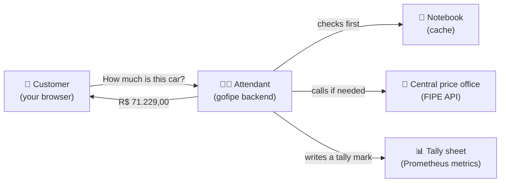
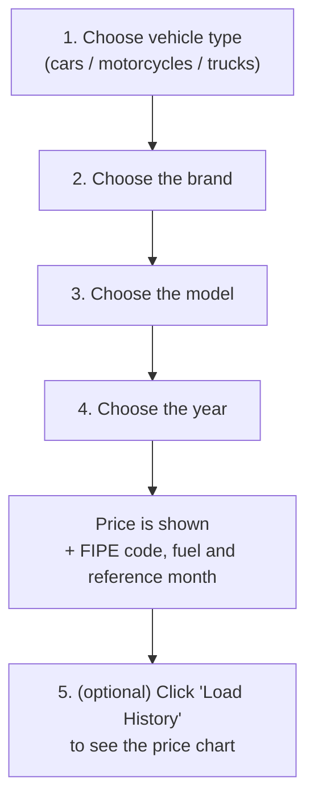
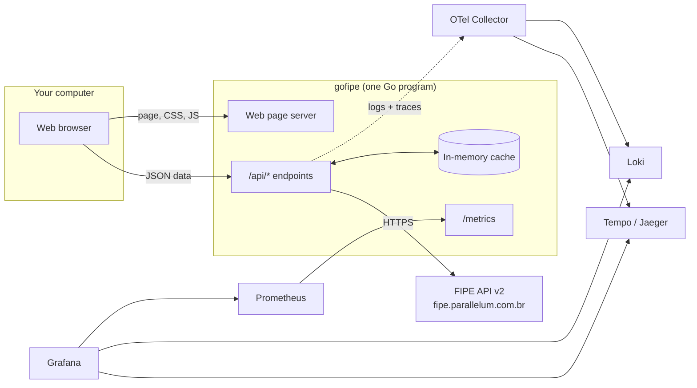

# 1. Overview

<!-- TOC -->

- [What problem does gofipe solve?](#what-problem-does-gofipe-solve)
- [The analogy: a car dealership's information desk](#the-analogy-a-car-dealerships-information-desk)
- [What the user sees](#what-the-user-sees)
- [The big picture](#the-big-picture)
- [What is in the repository](#what-is-in-the-repository)

<!-- TOC -->

## What problem does gofipe solve?

In Brazil, the **FIPE table** (Tabela FIPE) is the official reference for the average price of used vehicles. People check it before buying or selling a car, a motorcycle or a truck.

The FIPE data is available through a public API on the internet, but an API returns raw JSON, not something a person wants to read. **gofipe** is a small web application that:

1. Shows a friendly web page where you pick the vehicle type, brand, model and year.
2. Shows the current price and a chart with the price of the last months.
3. Counts what people search for, so the owner can see things like "the most searched model".

## The analogy: a car dealership's information desk

Imagine a car dealership with an **information desk**:

- **You (the customer)** walk to the desk and ask: *"How much is a 2014 Volkswagen Gol?"*
- **The attendant (gofipe's backend)** does not know every price by heart. They call the **central price office (FIPE API)**, write down the answer and give it to you.
- The attendant keeps a **notebook (the cache)**: if someone asks for the list of brands again five minutes later, they read it from the notebook instead of calling the office again.
- At the end of the day, the attendant has a **tally sheet (the metrics)** with how many people asked about each car.



## What the user sees



Each choice unlocks the next one, like a set of doors: you can only choose a model after you chose a brand.

## The big picture



- The **browser** only ever talks to gofipe, never directly to FIPE.
- **gofipe** is a single program written in [Go](https://go.dev).
- **Observability (optional)**: **Prometheus** collects the numbers exposed at `/metrics`, **Loki** stores the JSON logs, **Tempo** and **Jaeger** store the traces (sent through the **OpenTelemetry Collector**), and **Grafana** shows all of them in dashboards. `app/docker-compose.yaml` starts everything.

## What is in the repository

```text
gofipe/
├── app/                 # The Go application (backend + frontend files)
│   ├── main.go          # Program entry point: configuration and server start/stop
│   ├── handlers.go      # What happens for each URL (/api/brands, /api/price...)
│   ├── fipe.go          # Client that calls the FIPE API + price parsing
│   ├── cache.go         # The "notebook" (in-memory cache)
│   ├── metrics.go       # The "tally sheet" (Prometheus metrics + access log)
│   ├── telemetry.go     # The "flight recorder" (JSON logs, OpenTelemetry traces)
│   ├── main_test.go     # Automated tests
│   ├── templates/       # The HTML page
│   ├── static/          # CSS and JavaScript used by the page
│   ├── Dockerfile       # Recipe to build the Docker image
│   ├── dashboard/       # Grafana dashboards (metrics, logs, traces, business)
│   ├── observability/   # Configs: OTel Collector, Prometheus, Loki, Tempo, Grafana
│   └── docker-compose.yaml  # App + full observability stack together
├── helm-chart/          # Package to deploy the app on Kubernetes with Helm 4
├── scripts/deps.sh      # Checks/installs the development tools
├── mise.toml            # The exact versions of every development tool
├── Makefile             # make check-deps / make install-deps / ...
└── docs/                # You are here
```

Next: [2. Architecture](02-architecture.md)
