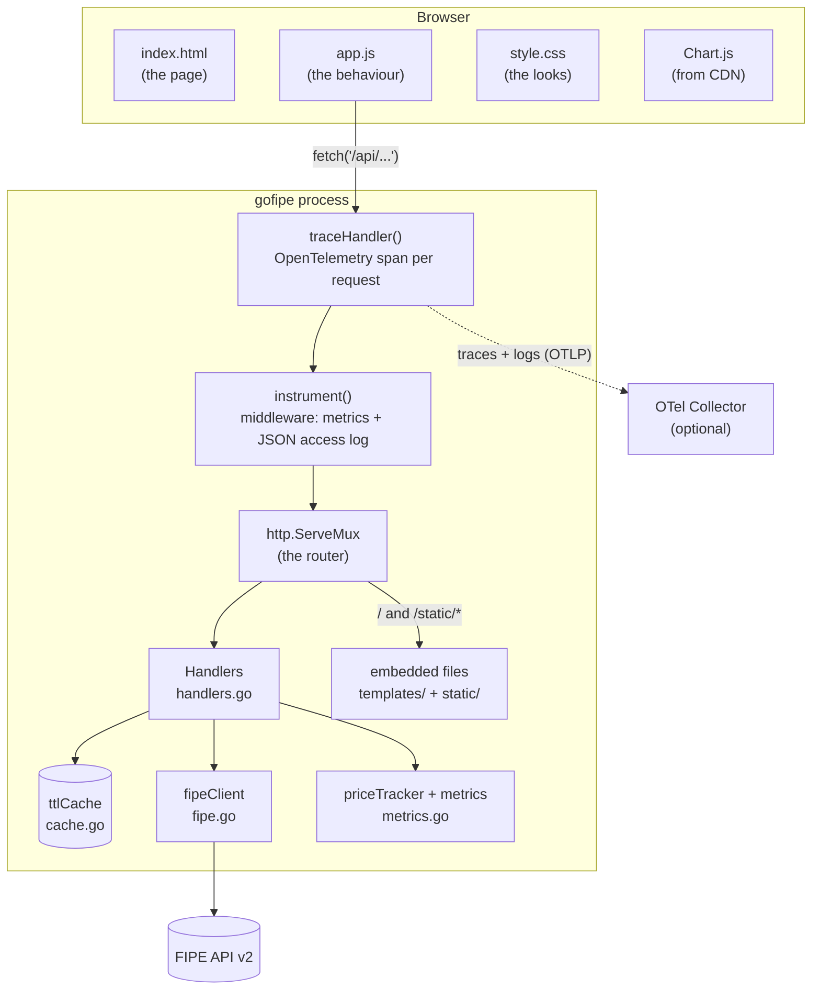
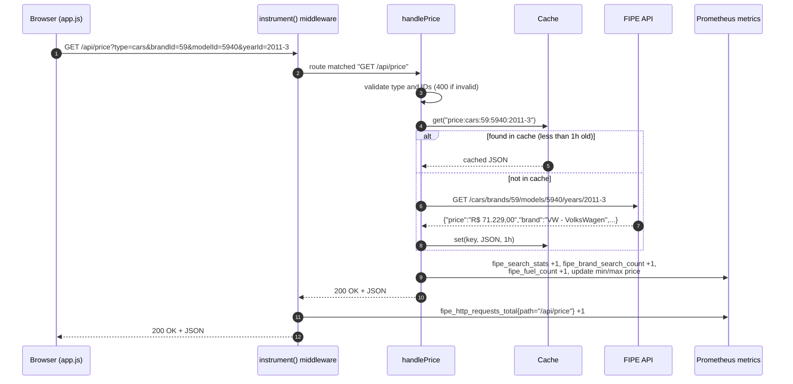
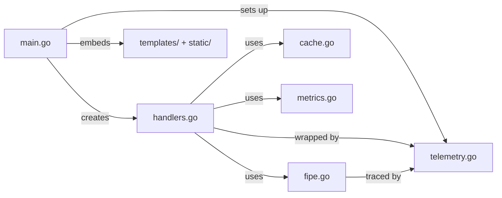

# 2. Architecture

<!-- TOC -->

- [The BFF pattern (Backend for Frontend)](#the-bff-pattern-backend-for-frontend)
- [Components](#components)
- [Endpoints](#endpoints)
- [The life of a request](#the-life-of-a-request)
- [How the Go files depend on each other](#how-the-go-files-depend-on-each-other)
- [Design decisions](#design-decisions)

<!-- TOC -->

## The BFF pattern (Backend for Frontend)

gofipe follows a pattern called **BFF – Backend for Frontend**.

> **Analogy – a translator at a business meeting.** The client (the browser) speaks only to its own translator (gofipe). The translator talks to the foreign company (FIPE), filters what matters, adds notes for the boss (metrics), and remembers recent answers (cache). The client never needs to know the foreign company's phone number, its rules or its rate limits.

Why not call FIPE directly from the browser?

| Without BFF (browser → FIPE) | With BFF (browser → gofipe → FIPE) |
|------------------------------|------------------------------------|
| Every browser hits FIPE, each with its own rate limit | gofipe caches answers and protects the FIPE quota |
| No way to count searches on the server | gofipe records Prometheus metrics |
| An API token would be visible to everyone | The token (`FIPE_API_TOKEN`) stays on the server |
| The page depends on the external URL shape | The page only knows `/api/*`, gofipe hides the details |

## Components

## Endpoints

| Method | Path | What it returns |
|--------|------|-----------------|
| `GET` | `/` | The HTML page |
| `GET` | `/static/...` | CSS and JavaScript files |
| `GET` | `/health` | `{"status": "ok"}` – Docker `HEALTHCHECK` (same as `/health/live`) |
| `GET` | `/health/live` | `{"status": "ok"}` – liveness/startup probe: the process answers |
| `GET` | `/health/ready` | `200 {"status": "ok"}` or `503 {"status": "unavailable"}` – readiness probe: 503 while starting or shutting down |
| `GET` | `/metrics` | Prometheus metrics (OpenMetrics text, with exemplars) |
| `GET` | `/api/brands?type=cars` | List of brands |
| `GET` | `/api/models?type=cars&brandId=59` | Models of a brand |
| `GET` | `/api/years?type=cars&brandId=59&modelId=5940` | Years of a model |
| `GET` | `/api/price?type=...&brandId=...&modelId=...&yearId=...` | Current price (**records business metrics**) |
| `GET` | `/api/priceHistory?...&months=12` | Price history, newest first |

`type` accepts only `cars`, `motorcycles` or `trucks`. IDs accept only letters, digits and `-`. Anything else returns **400 Bad Request**. Other HTTP methods (e.g. `POST`) return **405 Method Not Allowed**.

## The life of a request

Here is what happens when you select a year and the page asks for the price:

## How the Go files depend on each other

All Go files belong to the same package (`package main`), so they can use each other's functions directly. Think of them as rooms of the same house:

| File | Room in the house | Responsibility |
|------|-------------------|----------------|
| `main.go` | Front door | Reads configuration, starts and stops the server |
| `handlers.go` | Reception | Decides what to do for each URL |
| `fipe.go` | Telephone | Calls the FIPE API, converts prices to numbers |
| `cache.go` | Notebook | Remembers recent answers for a while |
| `metrics.go` | Tally sheet | Counts and times requests, counts searches, writes the access log |
| `telemetry.go` | Flight recorder | JSON logs, OpenTelemetry traces and log export |

## Design decisions

- **Single binary.** The HTML/CSS/JS files are embedded in the program with `//go:embed`, so the binary (and the Docker image) needs nothing else.
- **No database.** The cache lives in memory. If the app restarts, the cache is simply rebuilt. With several replicas (Kubernetes), each one has its own cache – that is fine for this use case.
- **Metric labels come from FIPE, not from the user.** This keeps the number of time series under control (see [Observability](06-observability.md)).
- **Graceful shutdown.** When Docker/Kubernetes asks the app to stop (signal `SIGTERM`), it reports "not ready", waits `SHUTDOWN_DELAY`, finishes in-flight requests and flushes telemetry before exiting.
- **JSON logs, optional tracing.** Logs are always JSON on stdout. Traces and OTLP log export turn on only when an OpenTelemetry endpoint is configured, so running the binary alone needs no extra service.

Next: [3. Backend in Go](03-backend-go.md)
