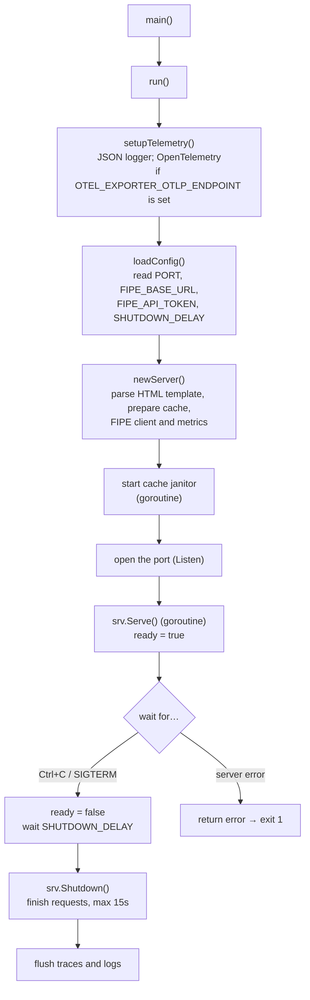
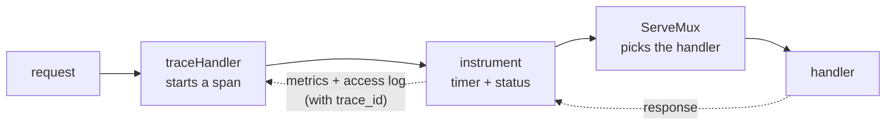

# 3. Backend in Go

<!-- TOC -->

- [Why Go?](#why-go)
- [main.go – the front door](#maingo--the-front-door)
  - [Configuration with environment variables](#configuration-with-environment-variables)
  - [Starting and stopping gracefully](#starting-and-stopping-gracefully)
- [handlers.go – the reception desk](#handlersgo--the-reception-desk)
  - [The router (ServeMux)](#the-router-servemux)
  - [Validating input](#validating-input)
  - [A handler step by step](#a-handler-step-by-step)
- [fipe.go – the telephone](#fipego--the-telephone)
  - [Errors with types](#errors-with-types)
  - [Turning "R$ 71.229,00" into a number](#turning-r-7122900-into-a-number)
- [telemetry.go – the flight recorder](#telemetrygo--the-flight-recorder)
- [cache.go and metrics.go](#cachego-and-metricsgo)
- [Modern Go features used](#modern-go-features-used)
- [Tests](#tests)

<!-- TOC -->

## Why Go?

[Go](https://go.dev) compiles to **one executable file** with no external runtime, starts in milliseconds, uses little memory and has an excellent HTTP server in its standard library. For a small web service like this one, we need only two external libraries: the [Prometheus client](https://github.com/prometheus/client_golang) (metrics) and [OpenTelemetry](https://opentelemetry.io/docs/languages/go/) (traces and log export).

## main.go – the front door

`main.go` is where the program starts:



### Configuration with environment variables

```go
cfg := config{
	Port:        cmp.Or(os.Getenv("PORT"), "8080"),
	FipeBaseURL: cmp.Or(os.Getenv("FIPE_BASE_URL"), defaultFipeBaseURL),
	FipeToken:   os.Getenv("FIPE_API_TOKEN"),
}
```

`cmp.Or(a, b)` returns the first value that is not empty. So, "use `$PORT` if it is set, otherwise `8080`".

| Variable | Default | Meaning |
|----------|---------|---------|
| `PORT` | `8080` | Port the server listens on |
| `FIPE_BASE_URL` | `https://fipe.parallelum.com.br/api/v2` | FIPE API address (tests point it to a fake server) |
| `FIPE_API_TOKEN` | *(empty)* | Optional token from [fipe.online](https://fipe.online) for higher limits and longer history |
| `SHUTDOWN_DELAY` | `0s` | How long to keep serving after `SIGTERM` while `/health/ready` answers 503 (the Helm chart uses `5s`). An invalid value stops the program at startup. |
| `OTEL_EXPORTER_OTLP_ENDPOINT`, `OTEL_SERVICE_NAME`, ... | *(empty)* | Standard OpenTelemetry variables; tracing is off while no endpoint is set. See [Observability](06-observability.md#turning-tracing-on). |

### Starting and stopping gracefully

> **Analogy – closing a shop.** A good shopkeeper does not slam the door on customers who are already inside. They lock the entrance (no new customers), serve the people inside, and only then go home.

`signal.NotifyContext` creates a *context* that is cancelled when the operating system sends `SIGINT` (Ctrl+C) or `SIGTERM` (what Docker/Kubernetes send). When that happens:

1. `ready` (an `atomic.Bool`) becomes `false`, so `/health/ready` answers **503** and Kubernetes stops sending new requests (the "closed" sign on the door);
2. the server keeps working for `SHUTDOWN_DELAY`, the time the load balancer needs to notice;
3. `srv.Shutdown` stops accepting connections and waits for the running requests to finish;
4. pending traces and logs are sent to the collector.

A second Ctrl+C exits immediately. The port is opened *before* `ready` becomes `true`, so the readiness check never says "ready" before the server can answer.

The server also has **timeouts** (`ReadHeaderTimeout`, `ReadTimeout`, `WriteTimeout`, `IdleTimeout`). Without them, a slow or malicious client could keep connections open forever and exhaust the server.

## handlers.go – the reception desk

### The router (ServeMux)

```go
mux.HandleFunc("GET /{$}", s.handleIndex)
mux.HandleFunc("GET /health/live", handleHealth)
mux.HandleFunc("GET /health/ready", s.handleReady)
mux.HandleFunc("GET /api/brands", s.handleBrands)
// ...
return traceHandler(instrument(mux))
```

> **Analogy – a building directory.** The router is the sign in the lobby: "Brands → 1st floor, Prices → 2nd floor". Each pattern says *which method* (`GET`) and *which path* goes to which handler.

- `"GET /{$}"` means *exactly* `/`. Unknown paths like `/xyz` get a **404**, instead of showing the home page.
- Because every pattern starts with `GET`, a `POST` gets **405 Method Not Allowed** automatically.
- `instrument(mux)` wraps the router to count and time every request and write one JSON access log line; `traceHandler(...)` wraps everything in an OpenTelemetry span (see [Observability](06-observability.md)).



### Validating input

Never trust what comes from the browser. Someone could call `/api/models?type=../../admin&brandId=1`. gofipe checks every parameter **before** building the FIPE URL:

```go
vehicleTypes = []string{"cars", "motorcycles", "trucks"}
idPattern    = regexp.MustCompile(`^[0-9A-Za-z-]{1,32}$`)
```

> **Analogy – a bouncer with a guest list.** If your name (the `type`) is not on the list, or your ID card has strange symbols, you do not get in (HTTP **400**).

### A handler step by step

```go
func (s *server) handleYears(w http.ResponseWriter, r *http.Request) {
	vType, ids, err := parseQuery(r, "brandId", "modelId") // 1. validate
	if err != nil {
		writeError(w, r, err)                                // 2. 400 on bad input
		return
	}
	brandID, modelID := ids[0], ids[1]
	s.proxy(w, r,
		fmt.Sprintf("years:%s:%s:%s", vType, brandID, modelID),          // 3. cache key
		fmt.Sprintf("/%s/brands/%s/models/%s/years", vType, brandID, modelID), // 4. FIPE path
		yearsTTL)                                                         // 5. keep for 24h
}
```

`proxy` = "look in the cache; if missing, ask FIPE, store the answer, and send it as JSON".

`writeError` turns errors into the right HTTP status and **never leaks internal details** (such as the upstream URL) to the browser – those go to the logs instead:

| Situation | Status sent to the browser |
|-----------|---------------------------|
| Invalid parameter | 400 Bad Request |
| FIPE says "not found" | 404 Not Found |
| FIPE says "too many requests" | 429 Too Many Requests |
| FIPE took too long | 504 Gateway Timeout |
| Any other FIPE failure | 502 Bad Gateway |

## fipe.go – the telephone

`fipeClient` knows how to call FIPE: the base URL, a shared `http.Client` with a 10-second timeout, the `User-Agent` header and the optional `X-Subscription-Token`. It uses the request's **context**, so if the browser gives up (closes the tab), the call to FIPE is cancelled too.

It also limits how many bytes it reads from FIPE (`io.LimitReader`, 5 MiB) – a safety net against unexpectedly huge answers.

### Errors with types

When FIPE answers with something other than `200 OK`, the client returns an `*upstreamError` that carries the status code. Later, `upstreamStatus` asks *"is this error an upstreamError?"* with the modern generic helper:

```go
if ue, ok := errors.AsType[*upstreamError](err); ok {
	// ue.StatusCode is available here
}
```

### Turning "R$ 71.229,00" into a number

Prometheus needs numbers, but FIPE returns text in Brazilian format. `parseFipePrice` finds the numeric part and figures out which symbol is the decimal separator:

| Input | Output |
|-------|--------|
| `R$ 71.229,00` | `71229` |
| `R$ 1.234.567,89` | `1234567.89` |
| `1,234.56` (US style) | `1234.56` |
| `71.229` (BR thousands, no cents) | `71229` |

## telemetry.go – the flight recorder

> **Analogy – an airplane's black box.** It records what happens during each flight so that, if something goes wrong, investigators can replay it. Traces and logs are the black box of each request.

| Function | What it does |
|----------|--------------|
| `setupTelemetry` | Always installs the **JSON** `slog` logger on stdout. If an OTLP endpoint is configured, also creates the OpenTelemetry tracer and logger providers (OTLP over HTTP) and sends each log line to the collector too (`slog.NewMultiHandler`). Returns a function that flushes everything on shutdown. |
| `traceContextHandler` | A `slog.Handler` wrapper that adds `trace_id` and `span_id` as top-level JSON keys when the log call has a context with a span (`slog.InfoContext(r.Context(), ...)`). |
| `otlpJSONHandler` | Formats the record with the same JSON handler and emits it as the **body** of an OpenTelemetry log record, so Loki receives exactly the line you see in `docker logs`. |
| `traceHandler` | Wraps the router with `otelhttp`: one server span per request, named after the matched route. Skips `/metrics` and `/health*`. |
| `tracedTransport` | Wraps the FIPE `http.Client` transport: one client span per call to FIPE, tagged `peer.service="fipe-api"`. |

That is why the handlers log with `slog.WarnContext(r.Context(), ...)` instead of `slog.Warn(...)`: the context carries the trace.

## cache.go and metrics.go

These two files are explained in their own chapters: [Cache and price history](05-cache-and-history.md) and [Observability](06-observability.md).

## Modern Go features used

The code follows the [Modern Go Guidelines](https://github.com/JetBrains/go-modern-guidelines) for Go 1.27:

| Feature | Since | Where |
|---------|-------|-------|
| Method + path patterns in `ServeMux` (`"GET /api/brands"`, `{$}`) | Go 1.22 | `handlers.go` |
| `r.Pattern` (matched route) | Go 1.23 | `metrics.go` (`instrument`) |
| `cmp.Or` for defaults | Go 1.22 | `main.go`, `handlers.go` |
| Built-in `min` / `max` | Go 1.21 | `metrics.go`, `handlers.go` |
| `slices.Contains`, `maps.DeleteFunc` | Go 1.21 | `handlers.go`, `cache.go` |
| `http.FileServerFS` + `embed.FS` | Go 1.22 / 1.16 | `main.go`, `handlers.go` |
| `log/slog` structured logging (JSON handler) | Go 1.21 | everywhere |
| `slog.NewMultiHandler` (one log call, several outputs) | Go 1.26 | `telemetry.go` |
| `sync/atomic.Bool` (typed atomics) | Go 1.19 | `handlers.go` (`ready`) |
| `errors.AsType[T]` | Go 1.26 | `fipe.go`, `handlers.go` |
| `encoding/json/v2` | Go 1.27 | `handlers.go`, tests |
| `t.Context()` in tests | Go 1.24 | `main_test.go` |

## Tests

`main_test.go` has automated tests that **do not need the internet**: they start a *fake* FIPE server with `httptest.NewServer` and point the app to it through `FIPE_BASE_URL`.

> **Analogy – a flight simulator.** Pilots practise in a simulator that behaves like a real plane. Our tests practise against a simulator that behaves like the real FIPE API.

```bash
cd app
make test    # go test -race ./...  (-race also detects concurrency bugs)
make cover   # shows the coverage per function
```

Next: [4. Frontend](04-frontend.md)
