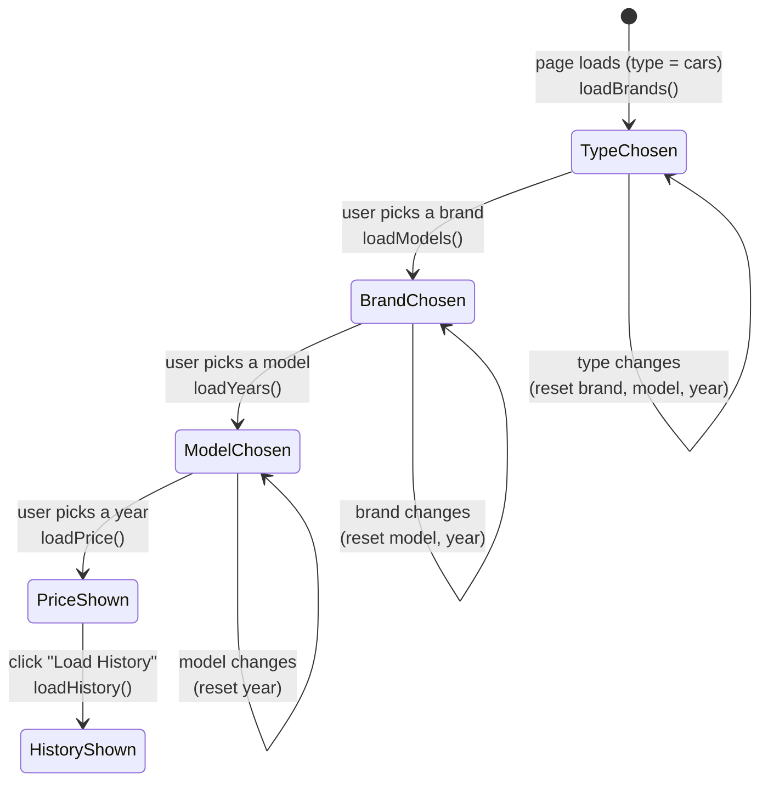
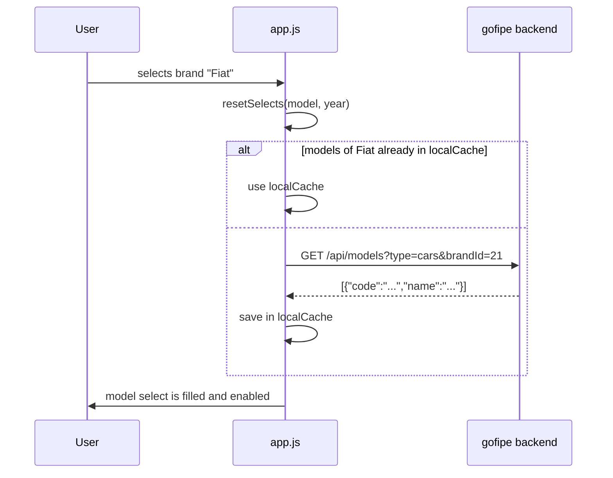

# 4. Frontend

<!-- TOC -->

- [Three files, three jobs](#three-files-three-jobs)
- [The cascading selects](#the-cascading-selects)
- [How JavaScript calls the backend](#how-javascript-calls-the-backend)
- [The price history chart](#the-price-history-chart)
- [Day/night theme](#daynight-theme)
- [External libraries](#external-libraries)

<!-- TOC -->

## Three files, three jobs

> **Analogy – a house.** HTML is the **structure** (walls, doors), CSS is the **decoration** (paint, furniture), JavaScript is the **electricity** (things that react when you press a switch).

| File | Job |
|------|-----|
| `app/templates/index.html` | Structure of the page: 4 select boxes, result box, chart canvas |
| `app/static/css/style.css` | Colours, layout and the day/night theme |
| `app/static/js/app.js` | Reacts to the user, calls `/api/*` and updates the page |

There is **no build step** (no npm, no React). The files are embedded into the Go binary and served as they are.

## The cascading selects

Each select box only becomes active after the previous one has a value. It is a small **state machine**:



When an earlier choice changes, every later select box is reset (`resetSelects`), because a model of "Fiat" makes no sense after you switch to "Honda".

## How JavaScript calls the backend

```js
const apiURL = (endpoint, params) => `/api/${endpoint}?${new URLSearchParams(params)}`;

const data = await fetchJSON(apiURL('years', {type, brandId, modelId}));
```

- `URLSearchParams` **encodes** every value safely (spaces, accents, `&`...).
- `fetchJSON` throws an error when the status is not 2xx; the error is shown with `alert(...)`.
- The page also keeps a small `localCache` object, so going back and forth between brands in the same session does not even reach the backend.



## The price history chart

`loadHistory()` calls `/api/priceHistory`, converts each price text (`"R$ 68.821,00"`) into a number, converts each month (`"outubro de 2026"`) into a date, sorts from oldest to newest and draws a line chart with [Chart.js](https://www.chartjs.org).

When you pick a different vehicle, the old chart is destroyed so it is never shown next to the wrong car.

## Day/night theme

The toggle in the header adds or removes the `theme-day` CSS class on `<body>` and remembers the choice in the browser's `localStorage`.

## External libraries

Bootstrap (CSS) and Chart.js are loaded from the jsDelivr CDN with **pinned versions** and **Subresource Integrity** (`integrity="sha384-..."`).

> **Analogy – a sealed package.** The `integrity` hash is like a tamper-evident seal: if the CDN ever served a modified file, the browser would refuse to run it.

Next: [5. Cache and price history](05-cache-and-history.md)
