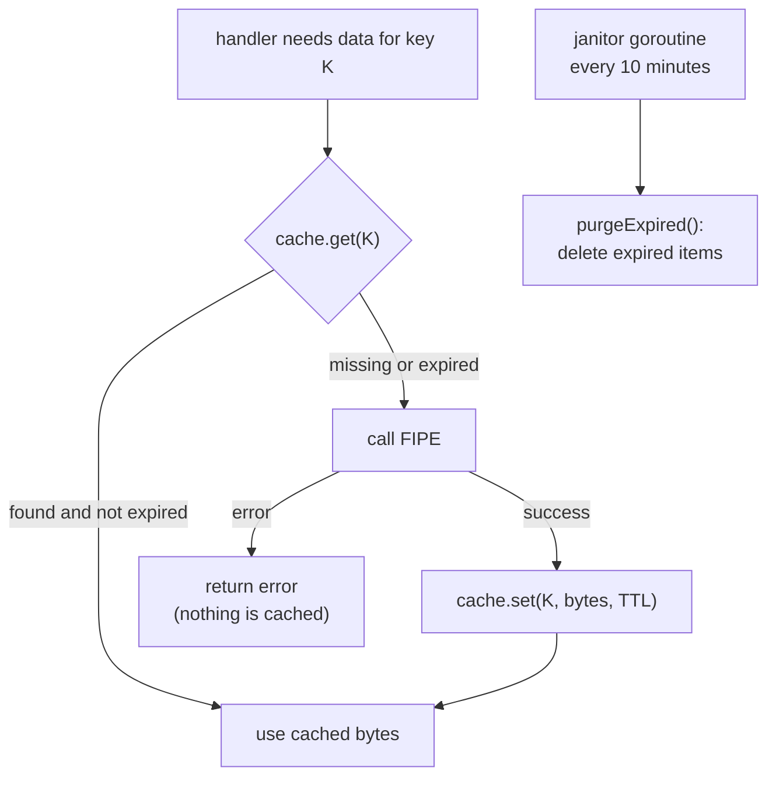
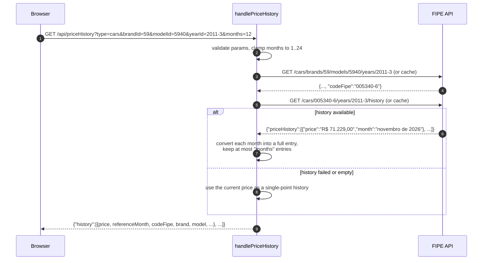

# 5. Cache and price history

<!-- TOC -->

- [The cache](#the-cache)
  - [Why cache?](#why-cache)
  - [How long each answer is kept](#how-long-each-answer-is-kept)
  - [How the cache works inside](#how-the-cache-works-inside)
  - [Concurrency: many requests at the same time](#concurrency-many-requests-at-the-same-time)
- [Price history](#price-history)
  - [Where the history comes from](#where-the-history-comes-from)
  - [How /api/priceHistory works](#how-apipricehistory-works)
  - [Limits of the free FIPE API](#limits-of-the-free-fipe-api)

<!-- TOC -->

## The cache

### Why cache?

> **Analogy – the attendant's notebook.** The list of car brands changes maybe once a month. If 1,000 people ask for it today, calling the central office 1,000 times is a waste of time (and the office may start ignoring you). The attendant writes the answer in a notebook with an **expiry time** and reads it from there.

Benefits:

- Faster answers (memory is much faster than the internet).
- Fewer calls to FIPE, so we stay below its **rate limit**.
- The app keeps working for cached data even if FIPE is briefly slow.

### How long each answer is kept

| Data | Cache key example | TTL (time to live) |
|------|-------------------|--------------------|
| Brands | `brands:cars` | 12 hours |
| Models | `models:cars:59` | 12 hours |
| Years | `years:cars:59:5940` | 24 hours |
| Current price | `price:cars:59:5940:2011-3` | 1 hour |
| Price history | `history:cars:005340-6:2011-3` | 6 hours |

Keys follow the convention `"<kind>:<part>:<part>"`. New cached endpoints must follow it too.

### How the cache works inside

`ttlCache` (in `cache.go`) is a Go `map[string]cacheItem`, where each item stores the bytes and the moment it expires.



The **janitor** is a background task (goroutine) that wakes up every 10 minutes and removes expired items. Without it, items that nobody asks for again would stay in memory forever.

### Concurrency: many requests at the same time

A web server handles many requests **at the same time**, each in its own goroutine. If two goroutines write to the same map at the same moment, Go crashes the program. To prevent that, the cache uses a `sync.RWMutex`:

> **Analogy – a library book.** Many people can **read** the same reference book at the same time (`RLock`). But when the librarian needs to **write** a correction in it (`Lock`), everybody waits until they finish.

The tests run with `go test -race`, which detects this kind of bug automatically.

## Price history

### Where the history comes from

The FIPE v2 API has a real history endpoint, but it is indexed by the **FIPE code** of the vehicle (e.g. `005340-6`), not by brand/model IDs:

```text
GET /{type}/{codeFipe}/years/{yearId}/history
```

So gofipe first needs to discover the FIPE code – it comes in the current price answer.

### How /api/priceHistory works



The answer keeps the same shape the frontend always expected: `{"history": [ ...price objects... ]}` ordered **newest first**. Every entry has the real `referenceMonth` from FIPE (older versions of gofipe guessed URLs and made up month labels; that is gone).

### Limits of the free FIPE API

Without a token, FIPE returns only the **last 3 months** of history and rejects older reference tables. With a subscription token (see [fipe.online](https://fipe.online)), set it in the environment and gofipe sends it on every request:

```bash
FIPE_API_TOKEN=your-token make -C app run
```

In Kubernetes, put the token in a Secret and reference it through the chart's `env` value (see [Deployment](07-deployment.md)).

Next: [6. Observability](06-observability.md)
