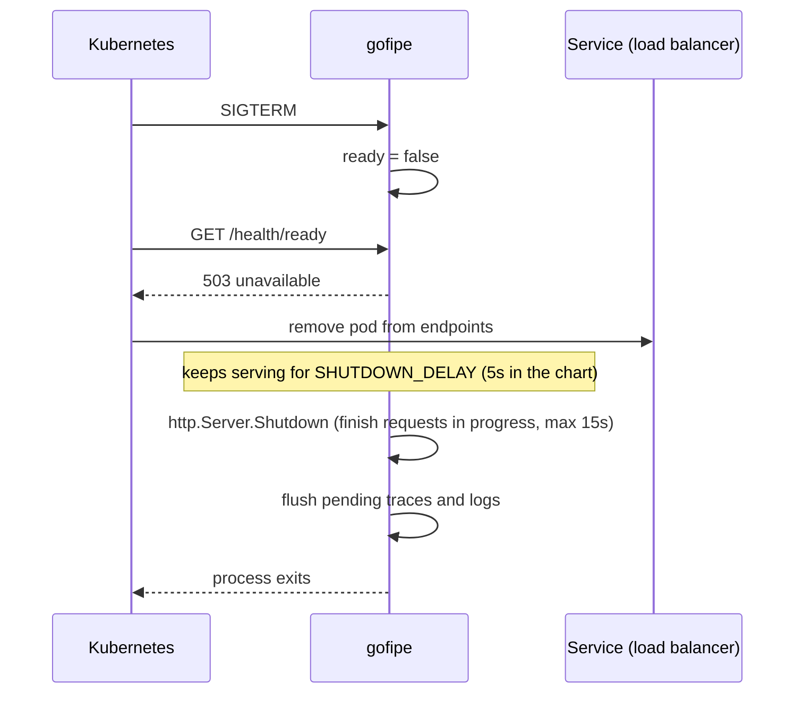
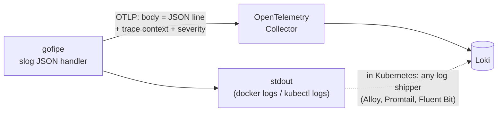
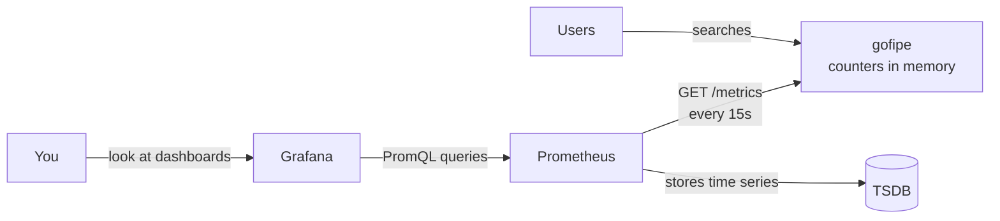
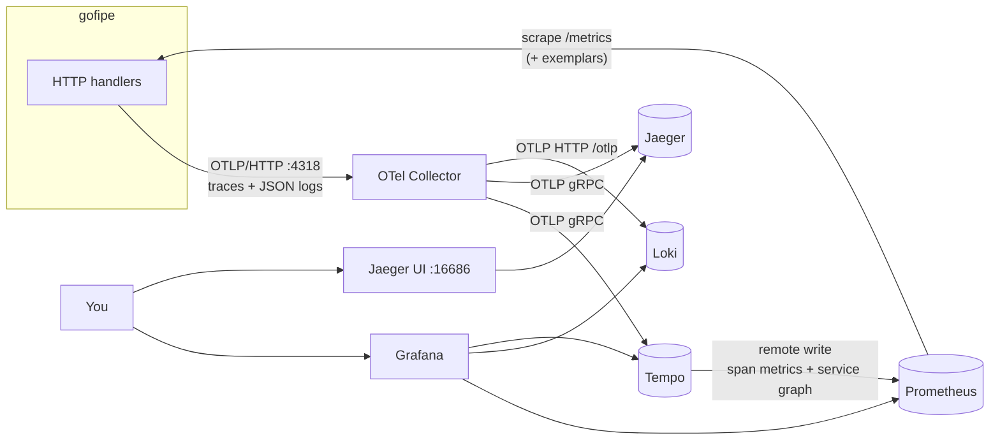
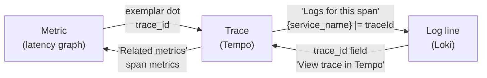

# 6. Observability

<!-- TOC -->

- [What is observability?](#what-is-observability)
- [Health checks](#health-checks)
- [Logs (JSON)](#logs-json)
  - [What a log line looks like](#what-a-log-line-looks-like)
  - [Querying logs in Loki (LogQL)](#querying-logs-in-loki-logql)
- [Metrics (Prometheus)](#metrics-prometheus)
  - [How Prometheus collects them](#how-prometheus-collects-them)
  - [Metric list](#metric-list)
  - [Keeping cardinality under control](#keeping-cardinality-under-control)
  - [Useful queries](#useful-queries)
- [Traces (OpenTelemetry, Tempo and Jaeger)](#traces-opentelemetry-tempo-and-jaeger)
  - [Spans created by gofipe](#spans-created-by-gofipe)
  - [Turning tracing on](#turning-tracing-on)
- [The local observability stack](#the-local-observability-stack)
  - [Starting it](#starting-it)
  - [How the pieces connect](#how-the-pieces-connect)
  - [Dashboards](#dashboards)
  - [Jumping between metrics, logs and traces](#jumping-between-metrics-logs-and-traces)
  - [Why Jaeger is not a Grafana data source](#why-jaeger-is-not-a-grafana-data-source)
- [Configuration files](#configuration-files)

<!-- TOC -->

## What is observability?

> **Analogy – a car dashboard.** You do not open the engine to know if the car is OK: the dashboard shows speed, fuel and warning lights. Observability is the dashboard of a program.

gofipe offers four "instruments":

| Instrument | Where | Answers the question | Stored in |
|------------|-------|----------------------|-----------|
| Health checks | `GET /health/live`, `GET /health/ready` | *Is the app alive? Can it take traffic?* | – (Docker / Kubernetes ask directly) |
| Logs | standard output (JSON) and OTLP | *What happened, and when?* | Loki |
| Metrics | `GET /metrics` | *How much / how many, over time?* | Prometheus |
| Traces | OTLP | *Where did this request spend its time?* | Tempo and Jaeger |

> **Analogy – the three pillars.** Imagine a delivery company. **Metrics** are the daily totals ("1,000 parcels, 3 % late"). **Logs** are the driver's diary ("10:02 – customer not at home"). A **trace** is the GPS track of *one* parcel, stop by stop. You use metrics to notice a problem, traces to find *where* it is and logs to read *why*.

## Health checks

| Endpoint | Answer | Used by | Meaning |
|----------|--------|---------|---------|
| `GET /health` | `200 {"status": "ok"}` | Docker `HEALTHCHECK` | Same as `/health/live` (kept for compatibility) |
| `GET /health/live` | `200 {"status": "ok"}` | Kubernetes **liveness** and **startup** probes | The process answers HTTP. If it fails, Kubernetes restarts the container. |
| `GET /health/ready` | `200 {"status": "ok"}` or `503 {"status": "unavailable"}` | Kubernetes **readiness** probe | The pod can receive traffic. `503` while starting and after `SIGTERM`. |

> **Analogy – a shop.** *Liveness* asks "is the shopkeeper awake?" (if not, call an ambulance = restart). *Readiness* asks "is the door open?" (if not, send customers to another shop = remove the pod from the Service). A shop can be awake but closing for the day.

None of these call the FIPE API. If FIPE is down, gofipe answers `502`/`504` to API calls but stays alive and ready, so Kubernetes does not restart every replica for a problem it cannot fix.

**Graceful shutdown.** When Kubernetes stops a pod it sends `SIGTERM`. gofipe then:



## Logs (JSON)

The app uses Go's structured logger `log/slog` with a **JSON handler**: every log entry is one JSON object per line. Machines (Loki, Elasticsearch, `jq`) can read every field without guessing.

> **Analogy – a form instead of a letter.** A free-text letter ("the customer from Rio asked for a car at 10am") must be read by a human. A form has boxes (`city`, `item`, `time`) that a machine can sort and count. JSON logs are forms.

### What a log line looks like

```json
{"time":"2026-11-16T09:43:42.143Z","level":"WARN","msg":"upstream request failed","trace_id":"598881fd27620572fb8cfe571cd92d78","span_id":"4961979fb901f0bb","path":"/api/models","status":404,"error":"FIPE API returned status 404 for /cars/brands/999999/models"}
{"time":"2026-11-16T09:43:42.143Z","level":"INFO","msg":"http request","trace_id":"598881fd27620572fb8cfe571cd92d78","span_id":"4961979fb901f0bb","method":"GET","route":"/api/models","status":404,"duration_ms":14}
```

| Field | Always present | Meaning |
|-------|----------------|---------|
| `time`, `level`, `msg` | yes | When, how serious (`DEBUG`, `INFO`, `WARN`, `ERROR`) and what happened |
| `trace_id`, `span_id` | inside a request | Links the line to its trace in Tempo/Jaeger. Always top-level keys. |
| `method`, `route`, `status`, `duration_ms` | access log (`msg = "http request"`) | One line per request. `route` is the matched route (never the raw URL); `status` and `duration_ms` are numbers. |
| `path`, `status`, `error` | `msg = "upstream request failed"` | Why a FIPE call failed |

Probe and scrape requests (`/health*`, `/metrics`) are **not** logged, so the logs are not flooded every few seconds.

The **same JSON line** goes to two places:



- **stdout** is always on. In Kubernetes, a log shipper can read it and send it to Loki; the JSON is parsed the same way.
- **OTLP** is on only when tracing is configured (see [Turning tracing on](#turning-tracing-on)). Loki also stores the trace ID as *structured metadata*.

### Querying logs in Loki (LogQL)

LogQL first selects a **stream** with labels (`{service_name="gofipe"}`), then filters and parses lines. `| json` turns every JSON key into a field you can filter, group by or turn into numbers.

```logql
# All warnings and errors
{service_name="gofipe"} | json | level=~"WARN|ERROR"

# Requests that returned 5xx
{service_name="gofipe"} | json | msg="http request" | status >= 500

# Every line of one request (paste a trace ID)
{service_name="gofipe"} |= "598881fd27620572fb8cfe571cd92d78" | json

# Requests per route (a metric built from logs)
sum by (route) (count_over_time({service_name="gofipe"} | json | msg="http request" [5m]))

# p95 latency per route, from the numeric field duration_ms
quantile_over_time(0.95, {service_name="gofipe"} | json | msg="http request" | unwrap duration_ms [5m]) by (route)
```

## Metrics (Prometheus)

### How Prometheus collects them

Prometheus works by **pulling**: every few seconds it visits `/metrics` and stores the numbers with a timestamp.

> **Analogy – a meter reader.** The electricity company sends someone to read your meter regularly. Your house does not call the company; the meter just shows the current number.



`/metrics` uses the **OpenMetrics** format so it can carry *exemplars* (see below).

### Metric list

| Metric | Type | Labels | Updated when |
|--------|------|--------|--------------|
| `fipe_http_requests_total` | Counter | `path`, `method` | Every HTTP request (by the `instrument` middleware) |
| `fipe_http_request_duration_seconds` | Histogram | `path`, `method`, `code` | Every HTTP request; has **exemplars** with the `trace_id` |
| `fipe_search_stats` | Counter | `brand_name`, `model_name`, `year_id` | Successful `/api/price` |
| `fipe_brand_search_count` | Counter | `brand_name` | Successful `/api/price` |
| `fipe_fuel_count` | Counter | `fuel` | Successful `/api/price` |
| `fipe_price_min` | Gauge | `brand_name`, `model_name`, `year_id` | Lowest price seen for that vehicle |
| `fipe_price_max` | Gauge | `brand_name`, `model_name`, `year_id` | Highest price seen for that vehicle |

Plus the default Go runtime and process metrics (`go_*`, `process_*`). With the full stack running, Tempo also writes **span metrics** (`traces_spanmetrics_*`) and **service graph** metrics (`traces_service_graph_*`) into Prometheus.

- A **counter** only goes up (like an odometer).
- A **gauge** goes up and down (like a thermometer).
- A **histogram** counts observations in buckets (`≤ 5ms`, `≤ 10ms`, ...), so Prometheus can compute percentiles such as p95.
- An **exemplar** is one real example attached to a bucket: "this request took 120 ms, here is its `trace_id`". In Grafana it is a dot on the latency graph that opens the trace.

Because a gauge cannot be "read back" from inside the app, `priceTracker` (in `metrics.go`) remembers the real minimum and maximum per vehicle and updates both gauges.

### Keeping cardinality under control

Each different combination of label values creates a new **time series** in Prometheus. If labels came straight from user input, anyone could create millions of series by sending random values, and Prometheus would run out of memory.

gofipe avoids that:

- `path` is the **matched route** (e.g. `/api/brands`), never the raw URL. Unknown URLs are grouped as `unmatched`.
- `method` is limited to the standard HTTP methods; anything else becomes `OTHER`.
- `brand_name` and `model_name` come from **FIPE's answer**, not from the query string, so they are limited to the real FIPE catalog.
- `trace_id` is **never** a label: it only appears in exemplars, which do not create series.

### Useful queries

```promql
# Top 5 most searched models
topk(5, sum by (model_name) (fipe_search_stats))

# Requests per second by route over the last 5 minutes
sum by (path) (rate(fipe_http_requests_total[5m]))

# p95 latency by route
histogram_quantile(0.95, sum by (le, path) (rate(fipe_http_request_duration_seconds_bucket{path=~"/api/.*"}[5m])))

# Share of 5xx responses
sum(rate(fipe_http_request_duration_seconds_count{code=~"5.."}[5m])) / sum(rate(fipe_http_request_duration_seconds_count[5m]))

# Distribution of searches by fuel
sum by (fuel) (fipe_fuel_count)
```

## Traces (OpenTelemetry, Tempo and Jaeger)

A **trace** is the story of one request. It is made of **spans**: each span is one step with a start, a duration and attributes. Spans have parents, so they form a tree (a "waterfall").

> **Analogy – a relay race.** The trace is the whole race; each runner's leg is a span. The baton (the *trace context*) is passed from runner to runner, so at the end you know exactly which leg was slow.

gofipe uses [OpenTelemetry](https://opentelemetry.io) (the vendor-neutral standard) and sends data with **OTLP** (the OpenTelemetry protocol) to a Collector, which forwards it to the backends.

### Spans created by gofipe

```mermaid
gantt
    title One request to /api/priceHistory (example)
    dateFormat x
    axisFormat %L ms
    section gofipe
    GET /api/priceHistory (server span)   :0, 180
    section FIPE API
    FIPE GET  price (client span)         :5, 80
    FIPE GET  history (client span)       :85, 175
```



| Span | Kind | Created by | Notes |
|------|------|------------|-------|
| `GET /api/...` | server | `traceHandler` (`otelhttp`) in `telemetry.go` | Named after the matched route; probes and `/metrics` are not traced. Status `error` for 5xx. |
| `FIPE GET` | client | `tracedTransport` (`otelhttp`) on the FIPE HTTP client | One per call to FIPE (cache hits create none). Has `peer.service="fipe-api"`, so Tempo's service graph shows FIPE as a node. |

The trace context is also sent to FIPE in the `traceparent` header (W3C Trace Context), which is harmless if FIPE ignores it.

### Turning tracing on

Tracing and OTLP log export are **off by default** (no overhead, no errors when there is no collector). They turn on when one of the standard OpenTelemetry variables is set:

| Variable | Example | Meaning |
|----------|---------|---------|
| `OTEL_EXPORTER_OTLP_ENDPOINT` | `http://otel-collector:4318` | Base URL of an OTLP/HTTP receiver (traces and logs) |
| `OTEL_EXPORTER_OTLP_TRACES_ENDPOINT` / `OTEL_EXPORTER_OTLP_LOGS_ENDPOINT` | | Per-signal endpoints (optional) |
| `OTEL_SERVICE_NAME` | `gofipe` (default) | Service name shown in Tempo, Jaeger and Loki (`service_name`) |
| `OTEL_RESOURCE_ATTRIBUTES` | `deployment.environment.name=local` | Extra attributes on every span and log |
| `OTEL_SDK_DISABLED` | `true` | Turns everything off even if an endpoint is set |

To send traces from `make run` to the local stack: `OTEL_EXPORTER_OTLP_ENDPOINT=http://localhost:4318 make -C app run`.

## The local observability stack

`app/docker-compose.yaml` runs gofipe and every backend, already connected and with the dashboards loaded:

| Service | Version | URL | Role |
|---------|---------|-----|------|
| gofipe | 4.1.0 | http://localhost:8080 | The app |
| OpenTelemetry Collector (contrib) | 0.165.0 | `localhost:4317` (gRPC), `localhost:4318` (HTTP) | Receives traces/logs and forwards them |
| Prometheus | v3.16.0 | http://localhost:9090 | Metrics (+ exemplars, + span metrics from Tempo) |
| Loki | 3.7.10 | http://localhost:3100 | Logs |
| Tempo | 3.1.1 | http://localhost:3200 | Traces (used by Grafana) |
| Jaeger | 2.23.0 | http://localhost:16686 | Traces (its own UI) |
| Grafana | 13.3.1 | http://localhost:3000 (`admin` / `admin`) | Dashboards and Explore |

> **Analogy – a post office.** The app drops letters (traces and logs) in one mailbox: the **Collector**. The Collector sorts them and delivers copies to the right archives (Tempo, Jaeger, Loki). Prometheus is the meter reader who visits on its own. Grafana is the reading room where you look at all archives side by side.

### Starting it

```bash
cd app
make compose-up          # docker compose up -d --build
# use the app a little: http://localhost:8080
# open Grafana: http://localhost:3000 -> Dashboards -> folder "gofipe"
make compose-down
```

If a port is already used on your machine, change the host port with an environment variable (the containers keep their internal ports):

```bash
GRAFANA_PORT=13000 GOFIPE_PORT=18080 make compose-up
# also: PROMETHEUS_PORT, JAEGER_PORT, LOKI_PORT, TEMPO_PORT, OTLP_GRPC_PORT, OTLP_HTTP_PORT
```

### How the pieces connect



### Dashboards

All dashboards live in `app/dashboard/` and are **provisioned automatically** (folder *gofipe* in Grafana). They use fixed data source UIDs (`prometheus`, `loki`, `tempo`), created by `app/observability/grafana/provisioning/datasources/datasources.yaml`.

| Dashboard (file) | Shows | Data sources |
|------------------|-------|--------------|
| **gofipe - Overview** (`gofipe-overview.json`, home dashboard) | RED metrics (rate, errors, p95 with exemplars), status codes, Go memory, log volume, warnings/errors, recent traces, service graph | Prometheus, Loki, Tempo |
| **gofipe - Logs** (`gofipe-logs.json`) | Log volume by level, status and p95 duration *computed from the JSON access logs*, top routes, FIPE failures, searchable log list (variables `Level` and `Search`) | Loki |
| **gofipe - Traces** (`gofipe-traces.json`) | Span metrics by operation (rate, errors, p95 – including time spent in FIPE), TraceQL searches (recent, slow, failed), service graph, link to the Jaeger UI | Prometheus (span metrics), Tempo |
| **gofipe - Business** (`dash-grafana.json`) | Searches, top brands/models, fuel distribution, observed min/max price per vehicle | Prometheus |

To use them in another Grafana, create data sources with the same UIDs (or replace the UIDs in the JSON files) and import the files.

### Jumping between metrics, logs and traces

The data sources are configured so you can click from one signal to another:



1. On *gofipe - Overview*, the latency panel shows **exemplar dots**. Hover one and click *View trace in Tempo*.
2. In the trace waterfall, click a span and then *Logs for this span*: Loki shows every JSON log line with that `trace_id`.
3. In any logs panel, expand a line: the `trace_id` field has a *View trace in Tempo* link.

### Why Jaeger is not a Grafana data source

Grafana's Jaeger plugin talks to Jaeger's legacy `/api/*` HTTP API. Jaeger **2.21 and newer** only serve the new `/api/v3` API, so the plugin cannot connect to the latest Jaeger. The stack therefore:

- sends **the same traces** to Tempo and Jaeger (the Collector exports to both);
- uses **Tempo** inside Grafana (with all the links above);
- offers the **Jaeger UI** at http://localhost:16686 (and a link on *gofipe - Traces*) to compare both tools.

## Configuration files

```text
app/
├── docker-compose.yaml                         # the whole stack
├── dashboard/                                  # Grafana dashboards (JSON)
└── observability/
    ├── otel-collector/config.yaml              # OTLP in -> Tempo, Jaeger, Loki
    ├── prometheus/prometheus.yml               # scrape targets
    ├── loki/config.yaml                        # single binary, filesystem storage
    ├── tempo/tempo.yaml                        # local storage + metrics generator
    └── grafana/provisioning/
        ├── datasources/datasources.yaml        # Prometheus, Loki, Tempo + correlations
        └── dashboards/dashboards.yaml          # loads app/dashboard/*.json
```

These settings are for **local development**: no authentication on the backends and data kept only in Docker volumes (`make compose-down` keeps them; `docker compose down -v` deletes them).

Next: [7. Deployment](07-deployment.md)
