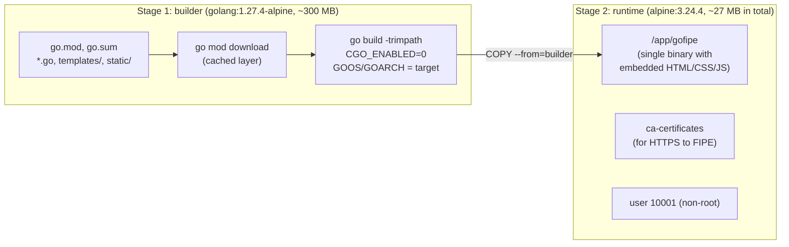
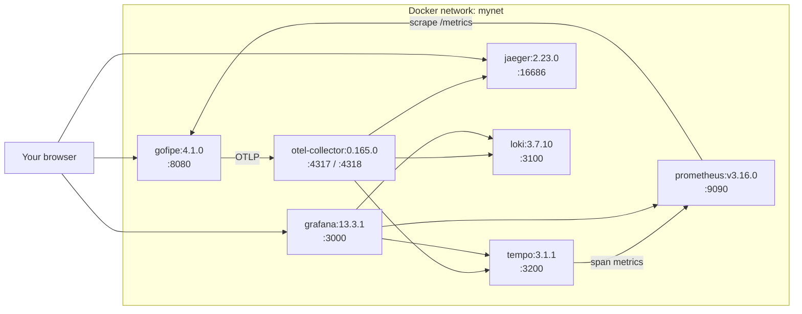
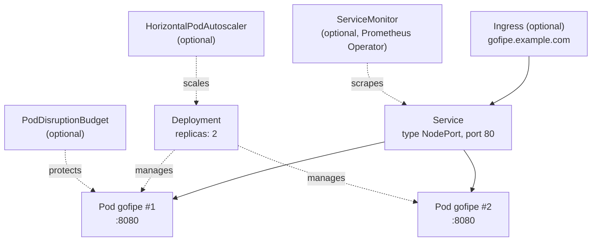
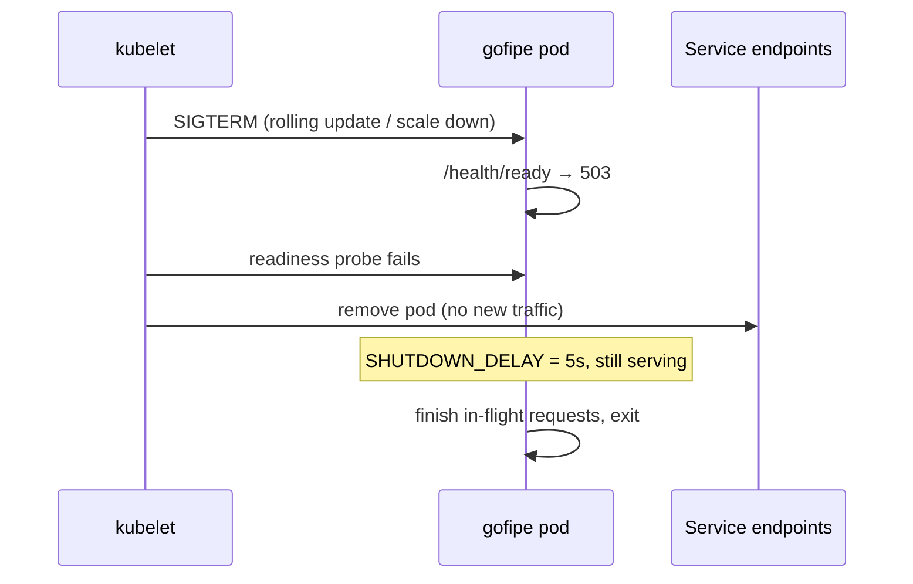

# 7. Deployment

<!-- TOC -->

- [Three ways to run gofipe](#three-ways-to-run-gofipe)
- [Docker image](#docker-image)
  - [Multi-stage build](#multi-stage-build)
  - [Multi-architecture images](#multi-architecture-images)
  - [Security of the image](#security-of-the-image)
- [Docker Compose](#docker-compose)
- [Kubernetes with Helm 4](#kubernetes-with-helm-4)
  - [What the chart creates](#what-the-chart-creates)
  - [Installing](#installing)
  - [Common customisations](#common-customisations)

<!-- TOC -->

## Three ways to run gofipe

| Way | Command | Good for |
|-----|---------|----------|
| Directly with Go | `make -C app run` | Developing |
| Docker | `docker run -p 8080:8080 aeciopires/gofipe:4.1.0` | Trying it out, single server |
| Kubernetes + Helm 4 | `make -C helm-chart install` | Production, many replicas |

## Docker image

> **Analogy – a lunch box.** A Docker image packs the program and everything it needs into a box that runs the same way on any computer with Docker.

### Multi-stage build

`app/Dockerfile` has two stages:

> **Analogy – a bakery.** The *kitchen* (builder stage) has ovens, flour and mixers. The *shop window* (runtime stage) only has the finished bread. Customers never need the oven.



### Multi-architecture images

`make -C app image` uses `docker buildx` to build for `linux/amd64`, `linux/arm/v6`, `linux/arm/v7` and `linux/arm64` (e.g. Raspberry Pi, AWS Graviton, Apple Silicon). The builder stage runs on your machine's architecture and **cross-compiles** Go for each target, which is much faster than emulating every platform.

### Security of the image

- Runs as the **non-root** user `10001`.
- Contains only the binary and CA certificates – no compiler, no source code.
- Has a `HEALTHCHECK` calling `/health` (Docker shows `healthy` / `unhealthy`).
- Is scanned with [Trivy](https://trivy.dev) (`make -C app scan`) – version 4.0.0 had **0 known vulnerabilities**.

## Docker Compose

`app/docker-compose.yaml` runs gofipe with a complete observability stack in one network:



Prometheus only starts after gofipe reports `healthy`. Grafana starts with the data sources and dashboards already configured. Host ports can be changed with variables such as `GRAFANA_PORT=13000`. See [Observability](06-observability.md#the-local-observability-stack) for the details.

## Kubernetes with Helm 4

> **Analogy – a franchise manual.** Kubernetes is a company that runs restaurants (containers) in many buildings (nodes). A **Helm chart** is the franchise manual: "open 2 restaurants, put a sign at the entrance (Service), restart any restaurant that stops answering (probes)". `values.yaml` holds the details you can customise for each city.

The chart requires **Helm 4** (Helm 3 is no longer supported) and Kubernetes 1.29+.

### What the chart creates



Each pod:

- runs as non-root with a read-only root filesystem and no Linux capabilities;
- receives `PORT` from `containerPort` and any extra variables from `env`;
- is checked by three probes:

| Probe | Path | When it fails |
|-------|------|---------------|
| `startupProbe` | `/health/live` every 2s, up to 30s | Kubernetes restarts the container (it never started) |
| `livenessProbe` | `/health/live` every 15s | Kubernetes restarts the container (it hangs) |
| `readinessProbe` | `/health/ready` every 5s | The pod is removed from the Service (no traffic), but not restarted |

- shuts down gracefully: on `SIGTERM` it answers 503 on `/health/ready`, keeps serving for `shutdownDelay` (5s, sent as `SHUTDOWN_DELAY`) so the Service stops routing to it, then finishes in-flight requests within `terminationGracePeriodSeconds` (30s).



### Installing

```bash
cd helm-chart
make lint       # helm lint --strict
make template   # see the generated YAML without a cluster
make install    # helm upgrade --install gofipe . -n gofipe --create-namespace --wait
kubectl port-forward svc/gofipe 8080:80 -n gofipe
# open http://localhost:8080
make uninstall
```

### Common customisations

Create a file `my-values.yaml` and pass it with `helm upgrade --install gofipe . -f my-values.yaml`:

```yaml
replicaCount: 3

# FIPE token from a Kubernetes Secret + traces/logs to an OpenTelemetry Collector
env:
  - name: FIPE_API_TOKEN
    valueFrom:
      secretKeyRef:
        name: gofipe-fipe-token
        key: token
  - name: OTEL_EXPORTER_OTLP_ENDPOINT
    value: http://otel-collector.observability.svc:4318

ingress:
  enabled: true
  className: nginx
  hosts:
    - host: gofipe.example.com
      paths:
        - path: /
          pathType: Prefix

podDisruptionBudget:
  enabled: true
  minAvailable: 1

serviceMonitor:
  enabled: true
```

All parameters are listed in [helm-chart/README.md](../helm-chart/README.md).

Next: [8. Development workflow](08-development-workflow.md)
