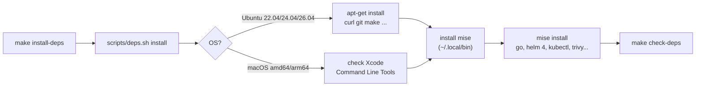
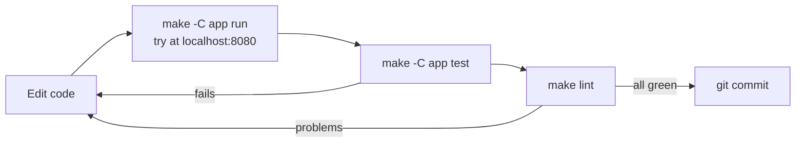
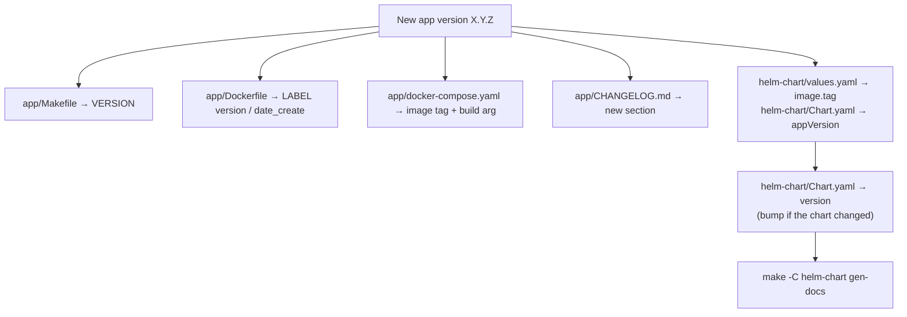

# 8. Development workflow

<!-- TOC -->

- [Setting up your machine](#setting-up-your-machine)
- [The daily loop](#the-daily-loop)
- [Make targets](#make-targets)
- [Quality checks](#quality-checks)
- [Updating dependencies](#updating-dependencies)
- [Releasing a new version](#releasing-a-new-version)

<!-- TOC -->

## Setting up your machine

> **Analogy – a toolbox with labels.** Instead of each developer buying random screwdrivers, the project has a labelled toolbox ([mise.toml](../mise.toml)) that says *exactly* which tool and which size to use. [mise](https://mise.jdx.dev) reads that label and gets the right tools for you.

```bash
# Docker must be installed first (see REQUIREMENTS.md)
make install-deps   # installs OS packages, mise and every pinned tool
make check-deps     # verifies everything (Docker included)
```



Full details: [REQUIREMENTS.md](../REQUIREMENTS.md).

## The daily loop



## Make targets

Run `make help` in any of the three directories to see the list.

| Directory | Target | What it does |
|-----------|--------|--------------|
| `/` | `check-deps` | Checks every required tool (also in `app/` and `helm-chart/`) |
| `/` | `install-deps` | Installs every required tool except Docker |
| `/` | `lint` / `test` | Runs everything for `app/` and `helm-chart/` |
| `app/` | `run` | `go run .` |
| `app/` | `build` | Builds `bin/gofipe` |
| `app/` | `test` / `cover` | Tests with race detector / coverage |
| `app/` | `lint` | golangci-lint + hadolint |
| `app/` | `vuln` | govulncheck |
| `app/` | `image-local` / `scan` | Local Docker image / Trivy scan |
| `app/` | `image` | Multi-arch build + push to Docker Hub + Trivy |
| `app/` | `compose-up` / `compose-down` | App + OTel Collector, Prometheus, Loki, Tempo, Jaeger and Grafana |
| `helm-chart/` | `lint`, `template`, `dry-run`, `install`, `uninstall`, `package`, `gen-docs` | Helm 4 operations |

The Makefiles call tools through `mise exec --`, so the pinned versions are always used. To use whatever is on your `PATH`, pass `MISE_EXEC=` (e.g. `make -C app test MISE_EXEC=`).

## Quality checks

| Tool | Checks | Analogy |
|------|--------|---------|
| `go test -race` | The code does what we expect, without data races | A test drive |
| `golangci-lint` | Bugs, unhandled errors, security smells, style (`app/.golangci.yml`) | A proofreader |
| `govulncheck` | Known vulnerabilities in Go and the libraries | A recall notice check |
| `hadolint` | Dockerfile best practices | A building inspector |
| `trivy` | Vulnerabilities inside the final image | Airport security scanner |
| `helm lint --strict` | Chart structure and values | A form validator |
| `shellcheck` | Shell script pitfalls | A spell checker for bash |

## Updating dependencies

- **Tools:** change the version in `mise.toml`, run `mise install`, update `REQUIREMENTS.md`.
- **Go modules:** `make -C app update-deps` (runs `go get -u ./...` and `go mod tidy`), then `make -C app test vuln`.
- **Go version:** update `mise.toml`, the `go` line in `app/go.mod` and the `golang:` image in `app/Dockerfile` together.
- **Docker images:** `alpine:` in `app/Dockerfile`; `prom/prometheus`, `grafana/grafana`, `grafana/loki`, `grafana/tempo`, `jaegertracing/jaeger` and `otel/opentelemetry-collector-contrib` in `app/docker-compose.yaml`. After a bump, run `make -C app compose-up` and check the logs of each service (config keys change between versions) and the dashboards in Grafana.
- **Dashboards:** edit them in Grafana, then *Export → Save to file* over the JSON in `app/dashboard/` (keep the data source UIDs `prometheus`, `loki`, `tempo`).

## Releasing a new version

The version is written in several places on purpose (there is no single source of truth). Update them together:



Then run `make -C app image` to build, push and scan the multi-arch image.

Back to the [index](README.md).
